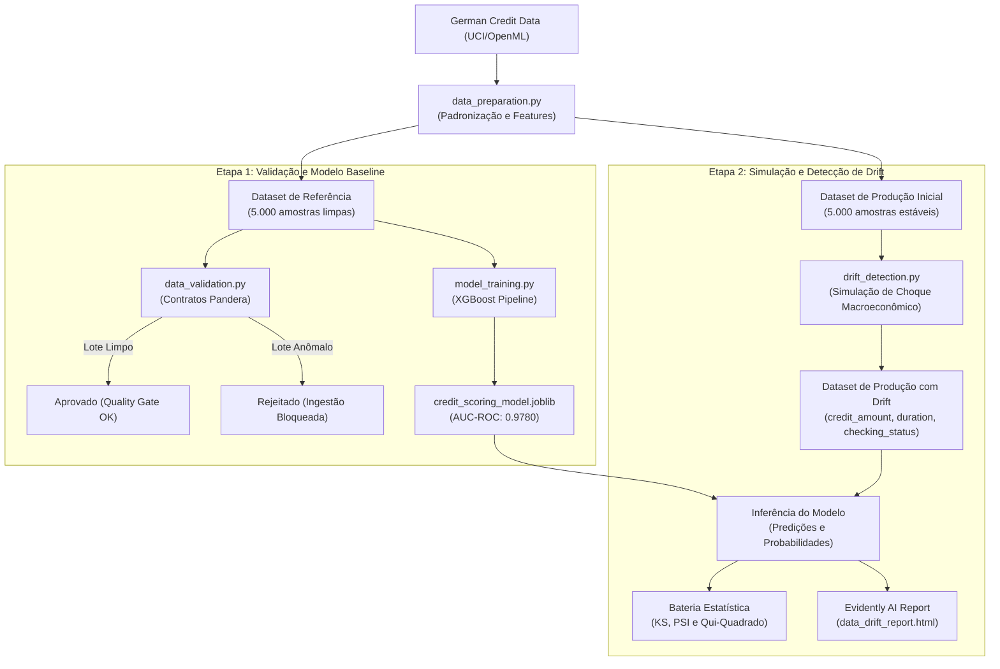

# Tech Challenge 04 — Observabilidade Contínua, Detecção de Drift, Qualidade de Dados e Governança

[](https://www.python.org/)
[](LICENSE)
[](https://xgboost.readthedocs.io/)
[](https://pandera.readthedocs.io/)
[](https://www.evidentlyai.com/)

---

## 1. Visão Geral e Contextualização do Problema

Em instituições financeiras e fintechs de concessão de crédito, modelos preditivos de **Credit Scoring** operam como componentes críticos na esteira de tomada de decisão, estimando a probabilidade de inadimplência (*Probability of Default* — PD) de novos proponentes. 

Entretanto, alterações nas condições macroeconômicas (tais como choques inflacionários, flutuações nas taxas de juros de mercado e retração da renda disponível) provocam a **degradação silenciosa** desses modelos em ambiente de produção:
- **Data Drift (Covariate Shift):** A distribuição das variáveis de entrada $P(X)$ se altera significativamente em relação aos dados observados na fase de treinamento.
- **Concept Drift:** A relação estocástica condicional $P(Y \mid X)$ entre as variáveis explicativas e o evento de inadimplência se modifica ao longo do tempo.
- **Deterioração Cadastral:** Lotes de ingestão com inconsistências, campos nulos ou categorias corrompidas ingressam inadvertidamente no pipeline.

O presente projeto estabelece a camada de **Sustentação, Observabilidade e Confiabilidade** de um sistema de Credit Scoring, cobrindo da ingestão à detecção formal de drift (Etapas 1 e 2 do Tech Challenge), em estrita conformidade com os requisitos de qualidade de software, rigor estatístico e governança de dados.

---

## 2. Dataset Utilizado: German Credit Data (Kaggle/UCI)

O conjunto de dados adotado é o **German Credit Data (Statlog)**, disponibilizado originariamente pela Universidade da Califórnia em Irvine (UCI Machine Learning Repository) e referenciado no Kaggle. 

O dataset contém atributos de proponentes a empréstimos bancários, com objetivo de classificar o risco de inadimplência em risco reduzido (*good* -> classe `0`) ou risco elevado (*bad* -> classe `1`).

### 2.1. Dicionário de Variáveis Principais

| Variável | Tipo | Descrição Técnica | Domínio / Limites |
| :--- | :--- | :--- | :--- |
| `client_id` | Numérico (Int) | Identificador unívoco sintético para controle transacional | Inteiro estritamente positivo |
| `duration` | Numérico (Int) | Prazo contratual do empréstimo expresso em meses | 4 a 72 meses |
| `credit_amount` | Numérico (Int) | Montante nominal do crédito concedido (Deutsche Mark) | 250 a 18.424 |
| `installment_commitment` | Numérico (Int) | Percentual de comprometimento da renda líquida | 1 a 4 |
| `age` | Numérico (Int) | Idade cronológica do solicitante em anos completos | 19 a 75 anos |
| `checking_status` | Categórico (Str) | Status da conta corrente do cliente na instituição | `<0`, `0<=X<200`, `>=200`, `no checking` |
| `savings_status` | Categórico (Str) | Faixa de saldo em contas de poupança/investimentos | `<100`, `100<=X<500`, `500<=X<1000`, `>=1000`, `no known savings` |
| `housing` | Categórico (Str) | Situação habitacional do proponente | `own`, `rent`, `for free` |
| `job` | Categórico (Str) | Nível de qualificação da ocupação profissional | 4 categorias padronizadas |
| `foreign_worker` | Categórico (Str) | Indicador de condição de trabalhador estrangeiro | `yes`, `no` |
| `credit_to_duration_ratio` | Numérico (Float) | Atributo derivado: razão entre montante e prazo | Valor contínuo positivo |
| `installment_rate_burden` | Numérico (Float) | Atributo derivado: estimativa de encargo da parcela | Valor contínuo positivo |
| `target` | Binário (Int) | Variável-alvo de risco de crédito | `0` (adimplente) / `1` (inadimplente) |

### 2.2. Separação de Partições e Volume Amostral

A partir do dataset canônico de 1.000 observações da UCI, geram-se partições amostrais através de reamostragem estratificada controlada com perturbação gaussiana (*jittering*) de baixa variância, respeitando os domínios reais e as probabilidades conjuntas:
- **Dataset de Referência (`data/reference/reference_data.csv`):** 5.000 registros históricos equilibrados, utilizados no estabelecimento do contrato de dados e no treinamento do classificador baseline.
- **Dataset de Produção Inicial (`data/production/production_data_clean.csv`):** 5.000 registros representando o período de operação estável.
- **Dataset de Produção com Drift (`data/production/production_drifted.csv`):** 5.000 registros submetidos a choque macroeconômico simulado.

Essa metodologia preserva rigorosamente a estrutura original do German Credit Data e cumpre a recomendação volumétrica de ao menos 5.000 amostras, garantindo poder estatístico nos testes de hipótese.

---

## 3. Arquitetura da Solução

O fluxo da solução estrutura-se em barreiras modulares sequenciais:



---

## 4. Detalhamento das Etapas Desenvolvidas

### 4.1. Etapa 1 — Validação de Dados e Contratos (Data Contracts)

Para impedir a contaminação do pipeline preditivo por registros espúrios, implementa-se um contrato formal de qualidade via biblioteca **Pandera** (`DataFrameSchema`). 

#### Regras Rígidas Implementadas no Contrato:
1. **Unicidade de Identificador (`client_id`):** Chave primária obrigatória, não nula, com verificação estrita de ausência de duplicatas (`unique=True`).
2. **Maioridade Legal Obrigatória (`age`):** A idade deve situar-se no intervalo fechado $[18, 100]$ anos completos (`Check.greater_than_or_equal_to(18)`), impossibilitando a concessão ilegal a menores.
3. **Plano de Montante Concedido (`credit_amount`):** O montante financeiro deve ser estritamente superior a zero e limitado ao teto operacional de 50.000 DM (`Check.in_range(1, 50000)`).
4. **Prazo de Amortização (`duration`):** O prazo do financiamento deve situar-se entre 1 e 120 meses.
5. **Domínio Categórico Homologado (`checking_status`):** Aceitação exclusiva dos rótulos válidos `<0`, `0<=X<200`, `>=200` e `no checking`.
6. **Domínio Categórico Habitacional (`housing`):** Aceitação exclusiva de `own`, `rent` e `for free`.
7. **Variável-Alvo Estrita (`target`):** Aceitação unicamente dos valores binários $\{0, 1\}$.
8. **Consistência Contábil Derivada (`credit_to_duration_ratio`):** A razão contábil mensal calculada deve ser estritamente positiva.

#### Teste Defensivo com Injeção de Falhas (Falsificação):
O script `src/data_validation.py` submete ao contrato dois lotes distintos:
- **Lote Íntegro:** O Dataset de Referência é validado com sucesso (**Status: APROVADO**; 0 falhas).
- **Lote Corrompido:** Injetam-se propositalmente menores de idade (15 anos), valores de crédito negativos (-2500), valores nulos (NaN) em saldo de conta, strings inválidas (`housing = 'spaceship_station'`), alvos ilegais (`target = 9`) e duplicatas de ID. O contrato rejeita formalmente o lote (**Status: REJEITADO**; 31 violações interceptadas), demonstrando o bloqueio da ingestão antes da inferência.

### 4.2. Etapa 1 — Treinamento do Modelo Baseline de Risco de Crédito

Desenvolve-se um pipeline completo em scikit-learn integrando pré-processamento robusto e classificador **XGBoost** (`XGBClassifier`):
- **Pré-processamento (`ColumnTransformer`):** Padronização estatística com `StandardScaler` para as variáveis numéricas contínuas e codificação *One-Hot* via `OneHotEncoder(handle_unknown='ignore')` para as variáveis categóricas.
- **Divisão Estratificada:** Particionamento da base de referência em 80% treino (4.000 instâncias) e 20% teste independente (1.000 instâncias).
- **Desempenho Preditivo na Partição de Teste:**
  - **AUC-ROC:** `0.9780`
  - **Acurácia Global:** `92.60%`
  - **Precisão:** `93.96%`
  - **Recall:** `81.11%`
  - **F1-Score:** `0.8706`
- **Artefato Serializado:** O pipeline completo é persistido em `models/credit_scoring_model.joblib`.

---

### 4.3. Etapa 2 — Simulação de Degradação Temporal (Data Drift e Concept Drift)

Simula-se um cenário macroeconômico realista de crise e aceleração inflacionária:
1. **Drift em `credit_amount`:** Elevação média de **+44,8%** no valor solicitado pelos tomadores (deslocamento acentuado para a direita na densidade empírica), simulando perda de poder de compra.
2. **Drift em `duration`:** Aumento médio de **+62,4%** no prazo contratual (média passa de 20,8 para 33,7 meses), representando busca por diluição de parcelas.
3. **Drift Categórico em `checking_status`:** Frequência de clientes em situação de saldo devedor (`< 0`) salta de **28,9% para 56,8%**.
4. **Concept Drift:** Proponentes com montantes elevados e saldo devedor sofrem ampliação de inadimplência real, elevando a taxa de default de 30,4% para 40,5%.

---

### 4.4. Etapa 2 — Detecção Estatística e Relatórios de Observabilidade

O módulo `src/drift_detection.py` aplica testes de hipótese paramétricos e não-paramétricos, além da biblioteca **Evidently AI (0.7+)**:

#### Métodos Estatísticos Aplicados:
- **Teste de Kolmogorov-Smirnov (KS-test):** Avalia a máxima distância $D$ entre as funções de distribuição acumulada (FDA) empíricas.
- **Population Stability Index (PSI):** Métrica canônica do setor bancário calculada via discretização em decis da base de referência:
  $$\text{PSI} = \sum_{i=1}^{k} (P_{\text{prod}, i} - P_{\text{ref}, i}) \times \ln\left(\frac{P_{\text{prod}, i}}{P_{\text{ref}, i}}\right)$$
  - $\text{PSI} < 0,10$: Estabilidade;
  - $0,10 \le \text{PSI} < 0,25$: Alteração moderada;
  - $\text{PSI} \ge 0,25$: Deslocamento substancial (drift crítico).
- **Teste Qui-Quadrado ($\chi^2$):** Aplicado às distribuições de contingência das features categóricas.

#### Resultados Obtidos na Auditoria Estatística:

| Variável | Categoria | Teste Primário | Estatística | p-valor | Diagnóstico |
| :--- | :--- | :--- | :---: | :---: | :--- |
| `credit_amount` | Numérica | KS + PSI | $D = 0,1720$ | $5,57 \times 10^{-65}$ | **DRIFT DETECTADO** (PSI Severo) |
| `duration` | Numérica | KS + PSI | $D = 0,5210$ | $0,00 \times 10^{0}$ | **DRIFT DETECTADO** (PSI Crítico) |
| `credit_to_duration_ratio` | Numérica | KS + PSI | $D = 0,1690$ | $9,76 \times 10^{-63}$ | **DRIFT DETECTADO** |
| `installment_rate_burden` | Numérica | KS + PSI | $D = 0,2014$ | $4,22 \times 10^{-89}$ | **DRIFT DETECTADO** |
| `checking_status` | Categórica | Qui-Quadrado | $\chi^2 = 867,97$ | $7,84 \times 10^{-188}$ | **DRIFT DETECTADO** |
| `credit_history` | Categórica | Qui-Quadrado | $\chi^2 = 10,83$ | $0,0285$ | **DRIFT DETECTADO** |
| `age` | Numérica | KS + PSI | $D = 0,0122$ | $0,8508$ | **ESTÁVEL** |
| `housing` | Categórica | Qui-Quadrado | $\chi^2 = 0,18$ | $0,9133$ | **ESTÁVEL** |
| `foreign_worker` | Categórica | Qui-Quadrado | $\chi^2 = 0,00$ | $1,0000$ | **ESTÁVEL** |

#### Relatório Visual do Evidently AI:
O relatório interativo completo é exportado em formato HTML autossuficiente em `reports/data_drift_report.html`, apresentando:
- Indicador global de Data Drift do conjunto de features;
- Histogramas de densidade comparativos entre o Dataset de Referência e o Dataset de Produção;
- Estatísticas descritivas (média, desvio padrão, percentis e p-valores);
- Resumo executivo em formato legível por máquina (`reports/data_drift_summary.json`).

---

## 5. Estrutura do Repositório

```
Tech Challenge - 04/
├── main.py                         # Orquestrador executivo de ponta a ponta
├── requirements.txt                # Dependências declaradas do ambiente
├── .gitignore                      # Regras de exclusão do controle de versão
├── README.md                       # Documentação técnica e de governança
│
├── src/                            # Módulos de engenharia e modelagem
│   ├── __init__.py                 # Pacote Python
│   ├── data_preparation.py         # Etapa 0: Ingestão e partição de coortes
│   ├── data_validation.py          # Etapa 1: Data Contracts formais (Pandera)
│   ├── model_training.py           # Etapa 1: Treino e avaliação (XGBoost)
│   └── drift_detection.py          # Etapa 2: Simulação, KS/PSI e Evidently AI
│
├── data/                           # Dados estruturados
│   ├── raw/                        # Base bruta original da UCI (1.000 amostras)
│   ├── reference/                  # Partição de Referência limpa (5.000 amostras)
│   └── production/                 # Partição de Produção limpa e drifted
│
├── models/                         # Modelos e metadados
│   ├── credit_scoring_model.joblib # Pipeline serializado treinado
│   └── model_metrics.json          # Métricas de avaliação do classificador
│
└── reports/                        # Relatórios e evidências de observabilidade
    ├── data_validation_report.json # Registro de auditoria do contrato Pandera
    ├── baseline_model_evaluation.json
    ├── statistical_drift_tests.json# Matriz de testes estatísticos formais
    ├── data_drift_summary.json     # Sumário JSON emitido pelo Evidently AI
    └── data_drift_report.html      # Dashboard interativo HTML do Evidently
```

---

## 6. Instruções de Reprodução e Execução

### 6.1. Configuração do Ambiente Virtual

Recomenda-se a criação de um ambiente virtual isolado com Python 3.11 ou 3.12:

```bash
# Criação do ambiente virtual
python -m venv .venv

# Ativação do ambiente virtual
# No Windows (PowerShell):
.venv\Scripts\Activate.ps1
# No Windows (Prompt de Comando / CMD):
.venv\Scripts\activate.bat
# No Linux/macOS:
source .venv/bin/activate

# Instalação das dependências do projeto
pip install -r requirements.txt
```

### 6.2. Execução via Orquestrador Principal (`main.py`)

O orquestrador `main.py` permite tanto a execução encadeada quanto o acionamento de etapas individuais ou exibição de ajuda:

```bash
# 1. Exibir opções de linha de comando e ajuda
python main.py --help

# 2. Execução do pipeline completo integrado (Etapas 0, 1 e 2)
python main.py

# 3. Execução isolada da Etapa 0 (Aquisição e preparação dos dados)
python main.py --etapa 0

# 4. Execução isolada da Etapa 1 (Validação de contratos Pandera e treino do modelo XGBoost)
python main.py --etapa 1

# 5. Execução isolada da Etapa 2 (Simulação de drift, testes estatísticos e Evidently AI)
python main.py --etapa 2
```

### 6.3. Execução Modular dos Componentes Individuais (`src/`)

Caso prefira inspecionar ou debugar módulos de forma autônoma:

```bash
# Etapa 0: Aquisição e geração dos lotes sintéticos
python src/data_preparation.py
# (Opcional) Customizando volume amostral e semente:
python src/data_preparation.py --samples 5000 --seed 42

# Etapa 1.1: Validação de Contratos de Dados (Pandera) e teste de estresse
python src/data_validation.py

# Etapa 1.2: Treinamento do Modelo Baseline (XGBoost)
python src/model_training.py

# Etapa 2: Simulação de Drift, Bateria Estatística (KS/PSI/Chi2) e Evidently AI
python src/drift_detection.py
```

### 6.4. Visualização do Dashboard Interativo de Drift (HTML)

Após a execução da Etapa 2, o relatório interativo autossuficiente pode ser aberto diretamente no navegador:

```bash
# No Windows (PowerShell):
Start-Process "reports/data_drift_report.html"

# No Windows (CMD):
start reports/data_drift_report.html

# No Linux:
xdg-open reports/data_drift_report.html

# No macOS:
open reports/data_drift_report.html
```

## 👥 Autores

| Nome                                | Função no Projeto                               | GitHub
| :---------------------------------- | :---------------------------------------------- | :--- |
| **Mateus de Souza Nascimento**      | Analyst / DevOps / Data Scientist / ML Engineer | [GitHub](https://github.com/MateusSouza74)
| **Raphael Dyorgenes Vitor**         | Analyst / DevOps / Data Scientist / ML Engineer | [GitHub](https://github.com/RaphaelDyorgenes)
