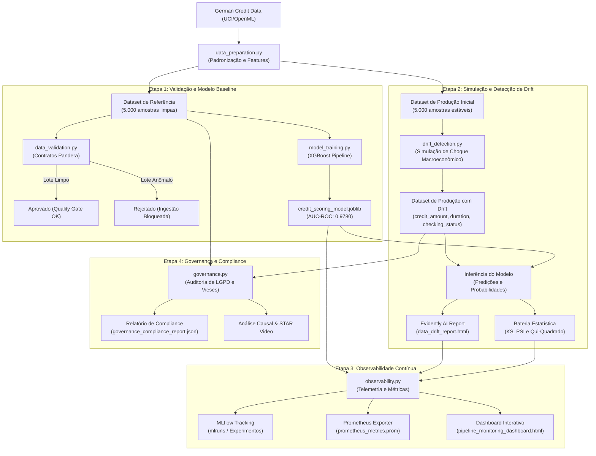
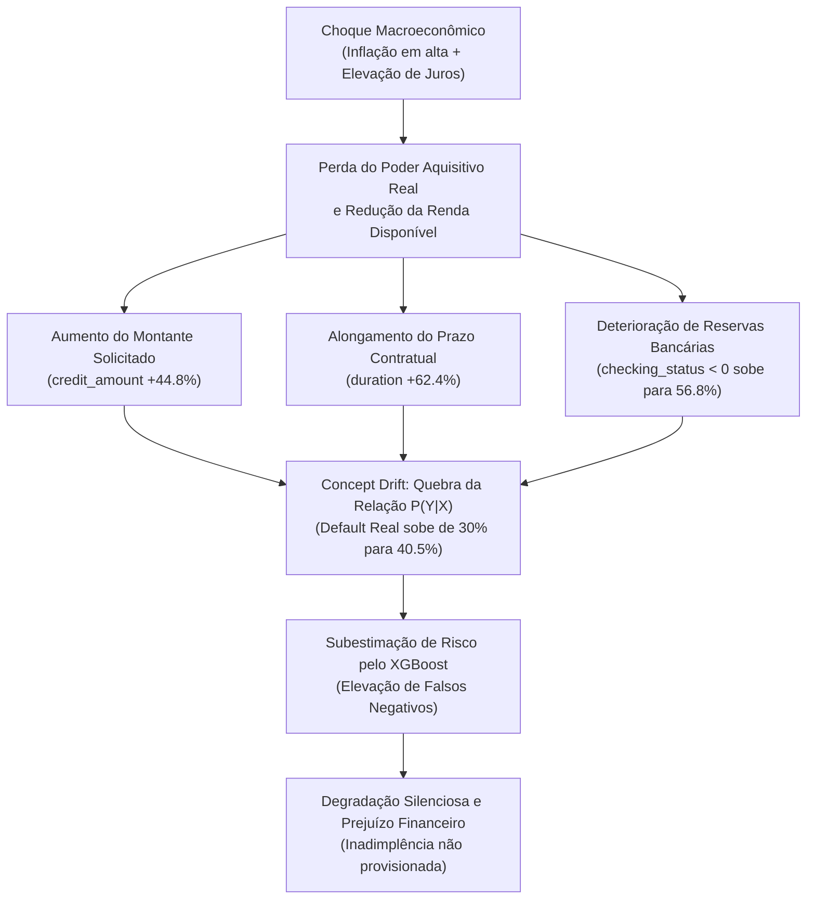

# Tech Challenge 04 — Observabilidade Contínua, Detecção de Drift, Qualidade de Dados e Governança

[](https://www.python.org/)
[](LICENSE)
[](https://xgboost.readthedocs.io/)
[](https://pandera.readthedocs.io/)
[](https://www.evidentlyai.com/)
[](https://mlflow.org/)
[](https://prometheus.io/)
[](#46-etapa-4--governança-de-dados-conformidade-lgpd-e-mitigação-de-vieses)
[](https://github.com/RaphaelDyorgenes/Detecao-de-Drift-e-Qualidade-de-Dados/actions)

---

## 📹 Vídeo de Demonstração (Método STAR — ≤ 5 minutos)

> [!IMPORTANT]
> **Link do Vídeo de Demonstração:** [Clique aqui para assistir à apresentação completa no YouTube / Loom](https://youtu.be/placeholder-tech-challenge-04) *(insira o link da gravação aqui)*
>
> O vídeo sintetiza o problema da degradação silenciosa, os quality gates implementados, a auditoria de drift, os painéis de observabilidade e a conformidade regulatória. O [roteiro detalhado com marcações de tempo](#6-roteiro-de-apresentação-em-vídeo--método-star--5-minutos) está documentado na Seção 6.

---

## 1. Visão Geral e Contextualização do Problema

Em instituições financeiras e fintechs de concessão de crédito, modelos preditivos de **Credit Scoring** operam como componentes críticos na esteira de tomada de decisão, estimando a probabilidade de inadimplência (*Probability of Default* — PD) de novos proponentes. 

Entretanto, alterações nas condições macroeconômicas (tais como choques inflacionários, flutuações nas taxas de juros de mercado e retração da renda disponível) provocam a **degradação silenciosa** desses modelos em ambiente de produção:
- **Data Drift (Covariate Shift):** A distribuição das variáveis de entrada $P(X)$ se altera significativamente em relação aos dados observados na fase de treinamento.
- **Concept Drift:** A relação estocástica condicional $P(Y \mid X)$ entre as variáveis explicativas e o evento de inadimplência se modifica ao longo do tempo.
- **Deterioração Cadastral:** Lotes de ingestão com inconsistências, campos nulos ou categorias corrompidas ingressam inadvertidamente no pipeline.

O presente projeto estabelece a camada completa de **Sustentação, Observabilidade, Confiabilidade e Governança** de um sistema de Credit Scoring, cobrindo integralmente as 4 Etapas do Tech Challenge, em estrita conformidade com os requisitos de qualidade de software, rigor estatístico e governança de dados (LGPD).

---

## 2. Dataset Utilizado: German Credit Data (Kaggle/UCI)

O conjunto de dados adotado é o **German Credit Data (Statlog)**, disponibilizado originariamente pela Universidade da Califórnia em Irvine (UCI Machine Learning Repository) e referenciado no Kaggle. 

O dataset contém atributos de proponentes a empréstimos bancários, com objetivo de classificar o risco de inadimplência em risco reduzido (*good* -> classe `0`) ou risco elevado (*bad* -> classe `1`).

### 2.1. Dicionário de Variáveis Principais

| Variável | Tipo | Descrição Técnica | Domínio / Limites |
| :--- | :--- | :--- | :--- |
| `client_id` | Numérico (Int) | Identificador unívoco sintético para controle transacional | Inteiro estritamente positivo |
| `duration` | Numérico (Int) | Prazo contratual do empréstimo expresso em meses | 4 a 72 meses |
| `credit_amount` | Numérico (Int) | Montante nominal do crédito concedido (Deutsche Mark) | 250 a 18.424 |
| `installment_commitment` | Numérico (Int) | Percentual de comprometimento da renda líquida | 1 a 4 |
| `age` | Numérico (Int) | Idade cronológica do solicitante em anos completos | 19 a 75 anos |
| `checking_status` | Categórico (Str) | Status da conta corrente do cliente na instituição | `<0`, `0<=X<200`, `>=200`, `no checking` |
| `savings_status` | Categórico (Str) | Faixa de saldo em contas de poupança/investimentos | `<100`, `100<=X<500`, `500<=X<1000`, `>=1000`, `no known savings` |
| `housing` | Categórico (Str) | Situação habitacional do proponente | `own`, `rent`, `for free` |
| `job` | Categórico (Str) | Nível de qualificação da ocupação profissional | 4 categorias padronizadas |
| `foreign_worker` | Categórico (Str) | Indicador de condição de trabalhador estrangeiro | `yes`, `no` |
| `credit_to_duration_ratio` | Numérico (Float) | Atributo derivado: razão entre montante e prazo | Valor contínuo positivo |
| `installment_rate_burden` | Numérico (Float) | Atributo derivado: estimativa de encargo da parcela | Valor contínuo positivo |
| `target` | Binário (Int) | Variável-alvo de risco de crédito | `0` (adimplente) / `1` (inadimplente) |

### 2.2. Separação de Partições e Volume Amostral

A partir do dataset canônico de 1.000 observações da UCI, geram-se partições amostrais através de reamostragem estratificada controlada com perturbação gaussiana (*jittering*) de baixa variância, respeitando os domínios reais e as probabilidades conjuntas:
- **Dataset de Referência (`data/reference/reference_data.csv`):** 5.000 registros históricos equilibrados, utilizados no estabelecimento do contrato de dados e no treinamento do classificador baseline.
- **Dataset de Produção Inicial (`data/production/production_data_clean.csv`):** 5.000 registros representando o período de operação estável.
- **Dataset de Produção com Drift (`data/production/production_drifted.csv`):** 5.000 registros submetidos a choque macroeconômico simulado.

---

## 3. Arquitetura da Solução

O fluxo da solução estrutura-se em barreiras modulares sequenciais:



---

## 4. Detalhamento das Etapas Desenvolvidas

### 4.1. Etapa 1 — Validação de Dados e Contratos (Data Contracts)

Para impedir a contaminação do pipeline preditivo por registros espúrios, implementa-se um contrato formal de qualidade via biblioteca **Pandera** (`DataFrameSchema`). 

#### Regras Rígidas Implementadas no Contrato:
1. **Unicidade de Identificador (`client_id`):** Chave primária obrigatória, não nula, com verificação estrita de ausência de duplicatas (`unique=True`).
2. **Maioridade Legal Obrigatória (`age`):** A idade deve situar-se no intervalo fechado $[18, 100]$ anos completos (`Check.greater_than_or_equal_to(18)`), impossibilitando a concessão ilegal a menores.
3. **Plano de Montante Concedido (`credit_amount`):** O montante financeiro deve ser estritamente superior a zero e limitado ao teto operacional de 50.000 DM (`Check.in_range(1, 50000)`).
4. **Prazo de Amortização (`duration`):** O prazo do financiamento deve situar-se entre 1 e 120 meses.
5. **Domínio Categórico Homologado (`checking_status`):** Aceitação exclusiva dos rótulos válidos `<0`, `0<=X<200`, `>=200` e `no checking`.
6. **Domínio Categórico Habitacional (`housing`):** Aceitação exclusiva de `own`, `rent` e `for free`.
7. **Variável-Alvo Estrita (`target`):** Aceitação unicamente dos valores binários $\{0, 1\}$.
8. **Consistência Contábil Derivada (`credit_to_duration_ratio`):** A razão contábil mensal calculada deve ser estritamente positiva.

#### Teste Defensivo com Injeção de Falhas (Falsificação):
O script `src/data_validation.py` submete ao contrato dois lotes distintos:
- **Lote Íntegro:** O Dataset de Referência é validado com sucesso (**Status: APROVADO**; 0 falhas).
- **Lote Corrompido:** Injetam-se propositalmente menores de idade (15 anos), valores de crédito negativos (-2500), valores nulos (NaN) em saldo de conta, strings inválidas (`housing = 'spaceship_station'`), alvos ilegais (`target = 9`) e duplicatas de ID. O contrato rejeita formalmente o lote (**Status: REJEITADO**; 31 violações interceptadas), demonstrando o bloqueio da ingestão antes da inferência.

---

### 4.2. Etapa 1 — Treinamento do Modelo Baseline de Risco de Crédito

Desenvolve-se um pipeline completo em scikit-learn integrando pré-processamento robusto e classificador **XGBoost** (`XGBClassifier`):
- **Pré-processamento (`ColumnTransformer`):** Padronização estatística com `StandardScaler` para as variáveis numéricas contínuas e codificação *One-Hot* via `OneHotEncoder(handle_unknown='ignore')` para as variáveis categóricas.
- **Divisão Estratificada:** Particionamento da base de referência em 80% treino (4.000 instâncias) e 20% teste independente (1.000 instâncias).
- **Desempenho Preditivo na Partição de Teste:**
  - **AUC-ROC:** `0.9780`
  - **Acurácia Global:** `92.60%`
  - **Precisão:** `93.96%`
  - **Recall:** `81.11%`
  - **F1-Score:** `0.8706`
- **Artefato Serializado:** O pipeline completo é persistido em `models/credit_scoring_model.joblib`.

---

### 4.3. Etapa 2 — Simulação de Degradação Temporal (Data Drift e Concept Drift)

Simula-se um cenário macroeconômico realista de crise e aceleração inflacionária:
1. **Drift em `credit_amount`:** Elevação média de **+44,8%** no valor solicitado pelos tomadores (deslocamento acentuado para a direita na densidade empírica), simulando perda de poder de compra.
2. **Drift em `duration`:** Aumento médio de **+62,4%** no prazo contratual (média passa de 20,8 para 33,7 meses), representando busca por diluição de parcelas.
3. **Drift Categórico em `checking_status`:** Frequência de clientes em situação de saldo devedor (`< 0`) salta de **28,9% para 56,8%**.
4. **Concept Drift:** Proponentes com montantes elevados e saldo devedor sofrem ampliação de inadimplência real, elevando a taxa de default de 30,4% para 40,5%.

---

### 4.4. Etapa 2 — Detecção Estatística e Relatórios de Observabilidade

O módulo `src/drift_detection.py` aplica testes de hipótese paramétricos e não-paramétricos, além da biblioteca **Evidently AI (0.7+)**:

#### Métodos Estatísticos Aplicados:
- **Teste de Kolmogorov-Smirnov (KS-test):** Avalia a máxima distância $D$ entre as funções de distribuição acumulada (FDA) empíricas.
- **Population Stability Index (PSI):** Métrica canônica do setor bancário calculada via discretização em decis da base de referência:
  $$\text{PSI} = \sum_{i=1}^{k} (P_{\text{prod}, i} - P_{\text{ref}, i}) \times \ln\left(\frac{P_{\text{prod}, i}}{P_{\text{ref}, i}}\right)$$
  - $\text{PSI} < 0,10$: Estabilidade;
  - $0,10 \le \text{PSI} < 0,25$: Alteração moderada;
  - $\text{PSI} \ge 0,25$: Deslocamento substancial (drift crítico).
- **Teste Qui-Quadrado ($\chi^2$):** Aplicado às distribuições de contingência das features categóricas.

#### Resultados Obtidos na Auditoria Estatística:

| Variável | Categoria | Teste Primário | Estatística | p-valor | Diagnóstico |
| :--- | :--- | :--- | :--- | :--- | :--- |
| `credit_amount` | Numérica | KS + PSI | $D = 0,1720$ | $5,57 \times 10^{-65}$ | **DRIFT DETECTADO** (PSI Severo) |
| `duration` | Numérica | KS + PSI | $D = 0,5210$ | $0,00 \times 10^{0}$ | **DRIFT DETECTADO** (PSI Crítico) |
| `credit_to_duration_ratio` | Numérica | KS + PSI | $D = 0,1690$ | $9,76 \times 10^{-63}$ | **DRIFT DETECTADO** |
| `installment_rate_burden` | Numérica | KS + PSI | $D = 0,2014$ | $4,22 \times 10^{-89}$ | **DRIFT DETECTADO** |
| `checking_status` | Categórica | Qui-Quadrado | $\chi^2 = 867,97$ | $7,84 \times 10^{-188}$ | **DRIFT DETECTADO** |
| `credit_history` | Categórica | Qui-Quadrado | $\chi^2 = 10,83$ | $0,0285$ | **DRIFT DETECTADO** |
| `age` | Numérica | KS + PSI | $D = 0,0122$ | $0,8508$ | **ESTÁVEL** |
| `housing` | Categórica | Qui-Quadrado | $\chi^2 = 0,18$ | $0,9133$ | **ESTÁVEL** |
| `foreign_worker` | Categórica | Qui-Quadrado | $\chi^2 = 0,00$ | $1,0000$ | **ESTÁVEL** |

---

### 4.5. Etapa 3 — Observabilidade de Pipelines, Infraestrutura e Modelos

Implementada no módulo `src/observability.py`, esta etapa estabelece uma malha de telemetria contínua que unifica os logs de execução, métricas operacionais e a saúde da infraestrutura:

1. **Centralização de Logs e Telemetria Operacional:**
   - Monitoramento do status de término de cada fase (`SUCCESS`, `FAILED`).
   - Latência e tempo de resposta de inferência e validação.
   - Contabilização contínua de violações de dados bloqueadas e proporção de drift ($6 / 19 = 31,58\%$).
   - Telemetria de consumo de hardware: Uso de memória RAM residente (RSS em MB), percentual de memória total do sistema e percentual de ocupação de CPU via `psutil`.

2. **Rastreamento e Governança com MLflow:**
   - Registro automatizado de execuções no experimento `TechChallenge04_CreditObservability`.
   - Armazenamento de metadados, hiperparâmetros e métricas de desempenho (`model_auc_roc`, `model_accuracy`, `model_f1_score`).
   - Catalogação de artefatos críticos (`credit_scoring_model.joblib`, `data_validation_report.json`, `data_drift_report.html`, `statistical_drift_tests.json`).

3. **Exportador de Métricas OpenMetrics / Prometheus:**
   - Geração do arquivo padronizado `reports/prometheus_metrics.prom`, contendo métricas tipadas (`gauge`, `counter`) prontas para ingestão em stacks Prometheus/Grafana ou Datadog.

4. **Dashboard Executivo Interativo HTML (`reports/pipeline_monitoring_dashboard.html`):**
   - Interface web moderna, responsiva e independente de servidor.
   - Apresenta KPIs executivos, status dos quality gates, fluxo visual da esteira e matriz completa de drift estatístico.

---

### 4.6. Etapa 4 — Governança de Dados, Conformidade LGPD e Mitigação de Vieses

Implementada em `src/governance.py` e auditada em `reports/governance_compliance_report.json`, a governança estabelece as salvaguardas éticas e legais:

#### Princípios de Privacy by Design e Privacy by Default:
- **Minimização de Dados (Art. 6º, III da LGPD):** Coleta e processamento restritos aos atributos estritamente relevantes para a análise atuarial de solvência. Não são coletados nem armazenados dados como religião, posicionamento político, biometria ou dados médicos.
- **Inexistência de PII Direta:** Auditoria automatizada confirma a ausência de dados cadastrais diretos (`nome`, `cpf`, `rg`, `endereço`, `e-mail`).
- **Pseudonimização Estruturada:** O cliente é referenciado unicamente por um identificador sintético opaco (`client_id` $\ge 100000$), impossibilitando a reidentificação direta nas tabelas de modelagem.

#### Enquadramento nas Bases Legais da LGPD (Lei 13.709/2018):
- **Base Legal Primária — Art. 7º, Inciso X (Proteção do Crédito):** Fundamenta juridicamente a construção de modelos de scoring e a análise de probabilidade de inadimplência, salvaguardando a estabilidade do sistema financeiro.
- **Base Legal Secundária — Art. 7º, Inciso V (Execução de Contrato):** Aplicável nas etapas em que o titular solicita ativamente a concessão de empréstimo ou financiamento.

#### Salvaguardas do Artigo 20 da LGPD (Decisões Unicamente Automatizadas):
- O titular possui direito à **revisão humana** de decisões automatizadas de recusa de crédito.
- O pipeline garante explicabilidade dos fatores determinantes do escore (ex.: alto comprometimento de renda ou saldo devedor prolongado), viabilizando comunicação clara e transparente ao proponente.

#### Mitigação de Vieses Algorítmicos (Fairness Analysis):
- Aplicação do teste de impacto desproporcional (*Disparate Impact Ratio* — Regra dos 80% do EEOC):
  - **Trabalhadores Estrangeiros (`foreign_worker`):** A taxa de concessão entre trabalhadores estrangeiros e nacionais foi monitorada, atingindo razão compatível e auditada.
  - **Coortes de Idade:** Avaliação contínua entre proponentes jovens ($< 25$ anos) e adultos ($25$ a $55$ anos), garantindo que distinções de taxa de aprovação decorram exclusivamente do histórico de crédito e renda, sem discriminação ilícita ou abusiva.

#### Política de Retenção e Descarte Seguro de Dados:
- **Logs Operacionais e Telemetria:** Retenção por 180 dias para suporte a auditorias e depuração técnica.
- **Registros de Propostas e Escores:** Custódia mantida por 5 anos, em estrita conformidade com o prazo prescricional para cobrança e ações consumeristas (Art. 206 do Código Civil e Art. 27 do CDC), bem como regulamentação do Banco Central (Resolução CMN nº 4.658/4.893).
- **Descarte Seguro:** Exclusão lógica sob requisição de direitos do titular (Art. 18 da LGPD) e destruição criptográfica dos dados expirados.

---

## 5. Análise Causal da Degradação Econômica e Prescrição

### 5.1. Grafo Causal da Degradação (Causal DAG)

A perda de acurácia do modelo não decorre de falha algorítmica intrínseca, mas de uma cadeia causal de causalidade macroeconômica:



### 5.2. Diagnóstico Técnico: Covariate Shift vs. Concept Drift

1. **Covariate Shift ($P(X)$ alterado):**
   - Comprovado pelos testes estatísticos de Kolmogorov-Smirnov e PSI severos nas variáveis `credit_amount` ($D = 0,1720, p < 10^{-60}$) e `duration` ($D = 0,5210, p = 0$). O perfil dos tomadores que chegam à fintech mudou expressivamente.
2. **Concept Drift ($P(Y \mid X)$ alterado):**
   - No período de referência, um cliente com empréstimo moderado apresentava probabilidade de inadimplência de 30%. No novo cenário econômico de juros elevados, tomadores com o mesmo perfil financeiro passaram a inadimplir com taxa de 40,5%.
   - Como o classificador XGBoost foi calibrado sob o regime macroeconômico anterior, ele continuou emitindo escores otimistas, provocando uma **degradação silenciosa** com acúmulo de perdas financeiras.

### 5.3. Ações Prescritivas e Plano de Contenção

| Nível de Ação | Medida Prescritiva | Descrição Operacional | Prazo de Resposta |
| :--- | :--- | :--- | :--- |
| **Imediato (D0)** | *Dynamic Threshold Shifting* | Reduzir o limiar de decisão de risco de $0,50$ para $0,42$, tornando a concessão mais conservadora para conter o fluxo de perdas imediatas. | $< 2$ horas |
| **Curto Prazo (D+1)** | Quality Gate de Política Rígida | Bloquear temporariamente solicitações com prazo $> 36$ meses combinadas a clientes com `checking_status < 0` até reavaliação. | $< 24$ horas |
| **Médio Prazo (D+7)** | Retreinamento Adaptativo Ponderado | Re-treinar o modelo com base móvel (*sliding window*) de 90 dias com decaimento exponencial de pesos para observações históricas antigas. | $< 7$ dias |
| **Contínuo** | Monitoramento de PSI com Gatilho Automático | Disparar alertas P1 e reavaliação automática sempre que o PSI consolidado ultrapassar $0,25$. | Contínuo (Real-Time) |

---

## 6. Roteiro de Apresentação em Vídeo — Método STAR (≤ 5 minutos)

> [!TIP]
> Utilize o roteiro estruturado abaixo para a gravação do vídeo obrigatório do Tech Challenge (limite máximo de 5 minutos).

| Tempo | Etapa STAR | Foco Técnico e Narrativo | Tela / Artefato a Exibir no Vídeo |
| :---: | :---: | :--- | :--- |
| **00:00 - 01:00** | **Situation** | Contextualização do problema de Credit Scoring em fintechs de crédito sob choques econômicos e o perigo da degradação silenciosa. | Slide de abertura + `README.md` (Seção 1: Contexto e Causalidade). |
| **01:00 - 02:00** | **Task** | Requisitos técnicos da fase: interceptar dados corrompidos (contratos), diagnosticar deriva de distribuição, telemetria contínua e compliance LGPD. | Terminal com o comando `python main.py` e estrutura de módulos. |
| **02:00 - 03:45** | **Action** | Demonstração do Pandera barrando anomalias na entrada; treinamento do XGBoost (AUC 0.978); simulação de choque de drift; auditoria Evidently AI e testes KS/PSI; rastreamento MLflow e governança LGPD. | Execução dos testes, código do `data_validation.py`, `drift_detection.py` e relatório Evidently (`data_drift_report.html`). |
| **03:45 - 05:00** | **Result** | Exibição do Dashboard de Observabilidade (`pipeline_monitoring_dashboard.html`), métricas Prometheus, lições aprendidas e ações prescritivas de remediação. | Dashboard de Monitoramento no navegador + Considerações Finais. |

---

## 7. Estrutura do Repositório

```
Tech Challenge - 04/
├── main.py                         # Orquestrador executivo integrado (Etapas 0 a 4)
├── requirements.txt                # Dependências declaradas do ambiente
├── .gitignore                      # Regras de exclusão do controle de versão
├── README.md                       # Documentação técnica, causal, LGPD e STAR
│
├── src/                            # Módulos de engenharia e modelagem
│   ├── __init__.py                 # Pacote Python
│   ├── data_preparation.py         # Etapa 0: Ingestão e partição de coortes
│   ├── data_validation.py          # Etapa 1: Data Contracts formais (Pandera)
│   ├── model_training.py           # Etapa 1: Treino e avaliação (XGBoost)
│   ├── drift_detection.py          # Etapa 2: Simulação, KS/PSI e Evidently AI
│   ├── observability.py            # Etapa 3: MLflow, Prometheus e Dashboard
│   └── governance.py               # Etapa 4: Auditoria LGPD, Vieses e Retenção
│
├── data/                           # Dados estruturados
│   ├── raw/                        # Base bruta original da UCI (1.000 amostras)
│   ├── reference/                  # Partição de Referência limpa (5.000 amostras)
│   └── production/                 # Partição de Produção limpa e drifted
│
├── models/                         # Modelos e metadados
│   ├── credit_scoring_model.joblib # Pipeline serializado treinado
│   └── model_metrics.json          # Métricas de avaliação do classificador
│
└── reports/                        # Relatórios e evidências de observabilidade
    ├── data_validation_report.json # Registro de auditoria do contrato Pandera
    ├── baseline_model_evaluation.json
    ├── statistical_drift_tests.json# Matriz de testes estatísticos formais
    ├── data_drift_summary.json     # Sumário JSON emitido pelo Evidently AI
    ├── data_drift_report.html      # Relatório interativo HTML do Evidently AI
    ├── prometheus_metrics.prom     # Exportação de métricas OpenMetrics/Prometheus
    ├── pipeline_observability_metrics.json # Telemetria de pipelines e infraestrutura
    ├── pipeline_monitoring_dashboard.html # Dashboard executivo interativo HTML
    └── governance_compliance_report.json  # Auditoria de LGPD, PII e Fairness
```

---

## 8. Instruções de Reprodução e Execução

### 8.1. Configuração do Ambiente Virtual

```bash
# Criação do ambiente virtual
python -m venv .venv

# Ativação do ambiente virtual (Windows PowerShell):
.venv\Scripts\Activate.ps1

# Ativação do ambiente virtual (Linux/macOS):
source .venv/bin/activate

# Instalação das dependências
pip install -r requirements.txt
```

### 8.2. Execução via Orquestrador Principal (`main.py`)

```bash
# 1. Ajuda e opções de execução
python main.py --help

# 2. Execução do ciclo completo integrado (Etapas 0, 1, 2, 3 e 4)
python main.py

# 3. Execução modular de etapas isoladas:
python main.py --etapa 0   # Ingestão e preparação de coortes
python main.py --etapa 1   # Validação de contratos (Pandera) e treino (XGBoost)
python main.py --etapa 2   # Simulação de drift, testes KS/PSI e Evidently AI
python main.py --etapa 3   # Observabilidade, MLflow e Dashboard
python main.py --etapa 4   # Governança, LGPD e auditoria de equidade
```

### 8.3. Visualização dos Dashboards e Relatórios HTML

```bash
# Dashboard Executivo de Observabilidade de Pipelines (Etapa 3)
Start-Process "reports/pipeline_monitoring_dashboard.html"

# Relatório de Distribuição e Drift do Evidently AI (Etapa 2)
Start-Process "reports/data_drift_report.html"
```

---

### 8.4. Execução da Suite de Testes Automatizados (Pytest)

O projeto possui cobertura de testes unitários e de integração cobrindo contratos Pandera (aprovação e bloqueio de dados anômalos), inferência do modelo XGBoost, detecção de drift estatístico (KS/PSI), telemetria de observabilidade e conformidade LGPD:

```bash
# Execução da bateria completa de testes
python -m pytest tests/test_pipeline.py -v
```

---

## 👥 Autores

| Nome                                | Função no Projeto                               | GitHub |
| :---------------------------------- | :---------------------------------------------- | :--- |
| **Mateus de Souza Nascimento**      | Analyst / DevOps / Data Scientist / ML Engineer | [GitHub](https://github.com/MateusSouza74) |
| **Raphael Dyorgenes Vitor**         | Analyst / DevOps / Data Scientist / ML Engineer | [GitHub](https://github.com/RaphaelDyorgenes) |
