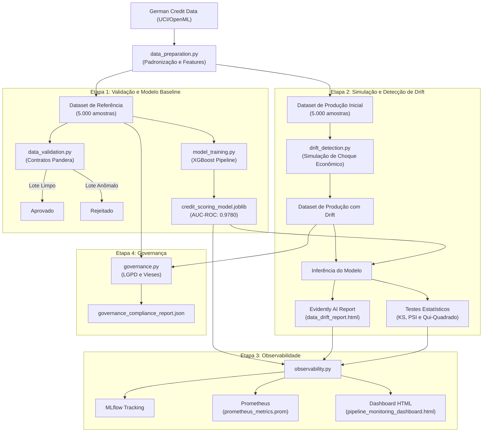
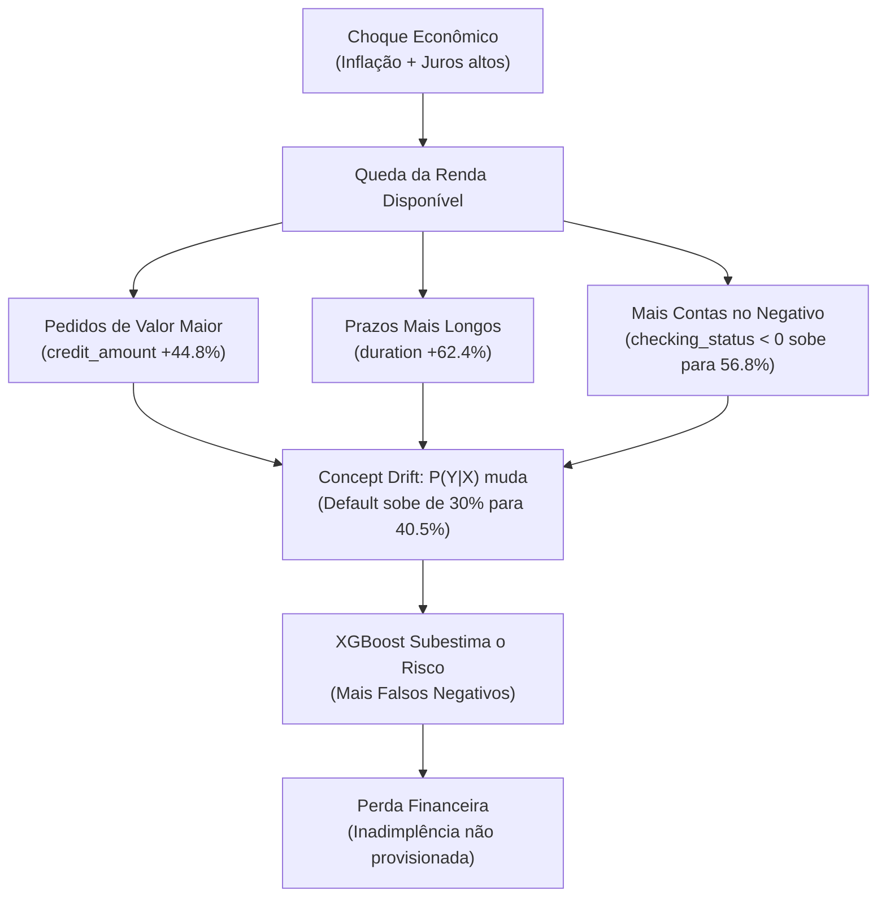

# Tech Challenge 04: Observabilidade, Detecção de Drift, Qualidade de Dados e Governança

[](https://www.python.org/)
[](https://xgboost.readthedocs.io/)
[](https://pandera.readthedocs.io/)
[](https://www.evidentlyai.com/)
[](https://mlflow.org/)
[](https://prometheus.io/)
[](https://github.com/RaphaelDyorgenes/Detecao-de-Drift-e-Qualidade-de-Dados/actions)

## 1. Contexto

Em empresas de crédito, o modelo de **Credit Scoring** estima a probabilidade de inadimplência (*Probability of Default*, PD) de quem pede um empréstimo. Quando a economia muda (inflação, juros, queda de renda), o modelo começa a errar sem que ninguém perceba:

- **Data Drift (Covariate Shift):** a distribuição das variáveis de entrada $P(X)$ fica diferente da que o modelo viu no treino.
- **Concept Drift:** a relação $P(Y \mid X)$ entre as variáveis e a inadimplência muda com o tempo.
- **Dados ruins na entrada:** lotes com nulos, categorias inválidas ou valores fora do domínio chegam ao pipeline.

Este projeto monta a camada de sustentação de um modelo de Credit Scoring: validação de dados, detecção de drift, observabilidade e governança (LGPD), cobrindo as 4 etapas do Tech Challenge.

## 2. Dataset: German Credit Data (Kaggle/UCI)

Usamos o **German Credit Data (Statlog)**, do UCI Machine Learning Repository (também disponível no Kaggle). Cada linha é um pedido de empréstimo e o alvo indica risco baixo (*good*, classe `0`) ou alto (*bad*, classe `1`).

### 2.1. Principais variáveis

| Variável | Tipo | Descrição | Domínio |
| :--- | :--- | :--- | :--- |
| `client_id` | Int | Identificador sintético do cliente | Inteiro positivo |
| `duration` | Int | Prazo do empréstimo em meses | 4 a 72 |
| `credit_amount` | Int | Valor do crédito (Deutsche Mark) | 250 a 18.424 |
| `installment_commitment` | Int | Comprometimento da renda | 1 a 4 |
| `age` | Int | Idade em anos | 19 a 75 |
| `checking_status` | Str | Situação da conta corrente | `<0`, `0<=X<200`, `>=200`, `no checking` |
| `savings_status` | Str | Faixa de saldo em poupança | `<100`, `100<=X<500`, `500<=X<1000`, `>=1000`, `no known savings` |
| `housing` | Str | Situação de moradia | `own`, `rent`, `for free` |
| `job` | Str | Qualificação profissional | 4 categorias |
| `foreign_worker` | Str | Trabalhador estrangeiro | `yes`, `no` |
| `credit_to_duration_ratio` | Float | Derivada: valor / prazo | Positivo |
| `installment_rate_burden` | Float | Derivada: estimativa do peso da parcela | Positivo |
| `target` | Int | Alvo | `0` (adimplente) / `1` (inadimplente) |

### 2.2. Partições

A base original tem 1.000 linhas. Para ter volume nos testes estatísticos, geramos novas amostras por reamostragem com um ruído gaussiano pequeno (*jittering*), respeitando os limites de cada variável:

- **Referência (`data/reference/reference_data.csv`):** 5.000 registros, usados no contrato de dados e no treino.
- **Produção inicial (`data/production/production_data_clean.csv`):** 5.000 registros do período estável.
- **Produção com drift (`data/production/production_drifted.csv`):** 5.000 registros após o choque econômico simulado.

## 3. Arquitetura



## 4. Etapas

### 4.1. Etapa 1: Validação de dados (Data Contracts)

O contrato de dados é um `DataFrameSchema` do **Pandera**. Regras:

1. **`client_id`:** obrigatório, não nulo e sem duplicatas (`unique=True`).
2. **`age`:** entre 18 e 100 anos (`Check.greater_than_or_equal_to(18)`).
3. **`credit_amount`:** maior que zero e até 50.000 DM (`Check.in_range(1, 50000)`).
4. **`duration`:** entre 1 e 120 meses.
5. **`checking_status`:** só `<0`, `0<=X<200`, `>=200` e `no checking`.
6. **`housing`:** só `own`, `rent` e `for free`.
7. **`target`:** só `0` ou `1`.
8. **`credit_to_duration_ratio`:** maior que zero.

Para testar o contrato, `src/data_validation.py` valida dois lotes:

- **Lote limpo:** a base de referência passa (**APROVADO**, 0 falhas).
- **Lote corrompido:** injetamos menores de idade (15 anos), crédito negativo (-2500), nulos em `checking_status`, `housing = 'spaceship_station'`, `target = 9` e IDs duplicados. O contrato rejeita o lote (**REJEITADO**, 31 violações) antes de chegar ao modelo.

### 4.2. Etapa 1: Modelo baseline

Pipeline do scikit-learn com **XGBoost** (`XGBClassifier`):

- **Pré-processamento (`ColumnTransformer`):** `StandardScaler` nas numéricas e `OneHotEncoder(handle_unknown='ignore')` nas categóricas.
- **Divisão estratificada:** 80% treino (4.000) e 20% teste (1.000).
- **Resultado no teste:**
  - AUC-ROC: `0.9780`
  - Acurácia: `92.60%`
  - Precisão: `93.96%`
  - Recall: `81.11%`
  - F1-Score: `0.8706`
- **Modelo salvo em:** `models/credit_scoring_model.joblib`.

### 4.3. Etapa 2: Simulação de drift

Simulamos um cenário de crise com inflação alta:

1. **`credit_amount`:** sobe **44,8%** em média.
2. **`duration`:** sobe **62,4%** em média (de 20,8 para 33,7 meses).
3. **`checking_status`:** clientes com saldo negativo (`< 0`) passam de **28,9% para 56,8%**.
4. **Concept drift:** clientes com valor alto e saldo negativo passam a inadimplir mais. A taxa de default vai de 30,4% para 40,5%.

### 4.4. Etapa 2: Detecção de drift

O módulo `src/drift_detection.py` roda testes estatísticos e gera o relatório do **Evidently AI (0.7+)**:

- **Kolmogorov-Smirnov (KS):** maior distância $D$ entre as distribuições acumuladas.
- **Population Stability Index (PSI):** calculado em decis da base de referência:
  $$\text{PSI} = \sum_{i=1}^{k} (P_{\text{prod}, i} - P_{\text{ref}, i}) \times \ln\left(\frac{P_{\text{prod}, i}}{P_{\text{ref}, i}}\right)$$
  - $\text{PSI} < 0,10$: estável
  - $0,10 \le \text{PSI} < 0,25$: mudança moderada
  - $\text{PSI} \ge 0,25$: drift relevante
- **Qui-quadrado ($\chi^2$):** para as variáveis categóricas.

#### Resultados

| Variável | Tipo | Teste | Estatística | p-valor | Resultado |
| :--- | :--- | :--- | :--- | :--- | :--- |
| `credit_amount` | Numérica | KS + PSI | $D = 0,1720$ | $5,57 \times 10^{-65}$ | **DRIFT** |
| `duration` | Numérica | KS + PSI | $D = 0,5210$ | $0,00 \times 10^{0}$ | **DRIFT** |
| `credit_to_duration_ratio` | Numérica | KS + PSI | $D = 0,1690$ | $9,76 \times 10^{-63}$ | **DRIFT** |
| `installment_rate_burden` | Numérica | KS + PSI | $D = 0,2014$ | $4,22 \times 10^{-89}$ | **DRIFT** |
| `checking_status` | Categórica | Qui-Quadrado | $\chi^2 = 867,97$ | $7,84 \times 10^{-188}$ | **DRIFT** |
| `credit_history` | Categórica | Qui-Quadrado | $\chi^2 = 10,83$ | $0,0285$ | **DRIFT** |
| `age` | Numérica | KS + PSI | $D = 0,0122$ | $0,8508$ | Estável |
| `housing` | Categórica | Qui-Quadrado | $\chi^2 = 0,18$ | $0,9133$ | Estável |
| `foreign_worker` | Categórica | Qui-Quadrado | $\chi^2 = 0,00$ | $1,0000$ | Estável |

### 4.5. Etapa 3: Observabilidade

Implementada em `src/observability.py`:

1. **Métricas do pipeline:**
   - Status de cada etapa (`SUCCESS`, `FAILED`).
   - Tempo de execução de validação e inferência.
   - Violações bloqueadas e proporção de variáveis com drift (6 de 19, 31,58%).
   - Uso de memória (RSS) e CPU via `psutil`.
2. **MLflow:**
   - Experimento `TechChallenge04_CreditObservability`.
   - Parâmetros e métricas do modelo (`model_auc_roc`, `model_accuracy`, `model_f1_score`).
   - Artefatos: `credit_scoring_model.joblib`, `data_validation_report.json`, `data_drift_report.html`, `statistical_drift_tests.json`.
3. **Prometheus:**
   - Arquivo `reports/prometheus_metrics.prom` no formato OpenMetrics (`gauge`, `counter`), pronto para Prometheus/Grafana.
4. **Dashboard (`reports/pipeline_monitoring_dashboard.html`):**
   - HTML único, abre direto no navegador.
   - Mostra os KPIs, o status de cada etapa e a tabela de drift.

### 4.6. Etapa 4: Governança e LGPD

Implementada em `src/governance.py`, com resultado em `reports/governance_compliance_report.json`.

#### Privacidade

- **Minimização (Art. 6º, III):** usamos só atributos relevantes para análise de crédito. Nada de religião, opinião política, biometria ou saúde.
- **Sem PII direta:** a auditoria confere que não há `nome`, `cpf`, `rg`, `endereço` ou `e-mail`.
- **Pseudonimização:** o cliente aparece só pelo `client_id` sintético ($\ge 100000$).

#### Bases legais (Lei 13.709/2018)

- **Art. 7º, X (proteção do crédito):** base principal para o scoring.
- **Art. 7º, V (execução de contrato):** quando o titular pede o empréstimo.

#### Art. 20 (decisões automatizadas)

- O titular tem direito a pedir **revisão humana** de uma recusa automática.
- O pipeline mantém os fatores que pesaram no escore (ex.: alto comprometimento de renda, saldo negativo) para que a decisão possa ser explicada.

#### Vieses (Fairness)

Usamos o *Disparate Impact Ratio* (regra dos 80% da EEOC):

- **`foreign_worker`:** comparamos a taxa de aprovação de estrangeiros e nacionais.
- **Idade:** comparamos jovens ($< 25$ anos) e adultos ($25$ a $55$ anos), para checar se a diferença vem do histórico de crédito e não da idade em si.

#### Retenção e descarte

- **Logs e telemetria:** 180 dias.
- **Propostas e escores:** 5 anos (prazo prescricional do Art. 206 do Código Civil e Art. 27 do CDC; Resoluções CMN 4.658/4.893).
- **Descarte:** exclusão a pedido do titular (Art. 18 da LGPD) e destruição dos dados vencidos.

## 5. Análise causal

### 5.1. Grafo causal

A queda de desempenho não é um problema do algoritmo, e sim uma consequência da mudança econômica:



### 5.2. Covariate shift x concept drift

1. **Covariate shift ($P(X)$ mudou):** KS e PSI altos em `credit_amount` ($D = 0,1720, p < 10^{-60}$) e `duration` ($D = 0,5210, p = 0$). O perfil de quem pede crédito mudou.
2. **Concept drift ($P(Y \mid X)$ mudou):** um cliente com empréstimo moderado tinha 30% de chance de inadimplir na referência. No cenário de juros altos, o mesmo perfil passa a 40,5%. Como o XGBoost foi treinado no cenário anterior, ele continua dando escores otimistas.

### 5.3. Ações recomendadas

| Prazo | Ação | O que fazer | Tempo |
| :--- | :--- | :--- | :--- |
| **Imediato (D0)** | Ajuste de threshold | Baixar o limiar de 0,50 para 0,42 para conceder com mais cautela. | $< 2$ horas |
| **Curto prazo (D+1)** | Regra de bloqueio | Segurar pedidos com prazo $> 36$ meses e `checking_status < 0` até reavaliação. | $< 24$ horas |
| **Médio prazo (D+7)** | Retreino | Retreinar com janela móvel de 90 dias e peso menor para dados antigos. | $< 7$ dias |
| **Contínuo** | Alerta de PSI | Disparar alerta e reavaliação quando o PSI passar de 0,25. | Contínuo |

## 6. Estrutura do repositório

```
.
├── main.py                         # Orquestrador (Etapas 0 a 4)
├── requirements.txt
├── .gitignore
├── README.md
│
├── src/
│   ├── __init__.py
│   ├── data_preparation.py         # Etapa 0: ingestão e partições
│   ├── data_validation.py          # Etapa 1: contratos Pandera
│   ├── model_training.py           # Etapa 1: treino XGBoost
│   ├── drift_detection.py          # Etapa 2: simulação, KS/PSI e Evidently
│   ├── observability.py            # Etapa 3: MLflow, Prometheus e dashboard
│   └── governance.py               # Etapa 4: LGPD, vieses e retenção
│
├── tests/
│   └── test_pipeline.py            # Testes (pytest)
│
├── data/
│   ├── raw/                        # Base original da UCI (1.000 linhas)
│   ├── reference/                  # Referência (5.000 linhas)
│   └── production/                 # Produção limpa e com drift
│
├── models/
│   ├── credit_scoring_model.joblib
│   └── model_metrics.json
│
└── reports/
    ├── data_validation_report.json
    ├── baseline_model_evaluation.json
    ├── statistical_drift_tests.json
    ├── data_drift_summary.json
    ├── data_drift_report.html
    ├── prometheus_metrics.prom
    ├── pipeline_observability_metrics.json
    ├── pipeline_monitoring_dashboard.html
    └── governance_compliance_report.json
```

## 7. Como rodar

### 7.1. Ambiente

```bash
python -m venv .venv

# Windows (PowerShell)
.venv\Scripts\Activate.ps1

# Linux/macOS
source .venv/bin/activate

pip install -r requirements.txt
```

### 7.2. Pipeline

```bash
python main.py --help

# Todas as etapas
python main.py

# Uma etapa só
python main.py --etapa 0   # Preparação dos dados
python main.py --etapa 1   # Contratos (Pandera) e treino (XGBoost)
python main.py --etapa 2   # Drift, KS/PSI e Evidently
python main.py --etapa 3   # Observabilidade, MLflow e dashboard
python main.py --etapa 4   # Governança e LGPD
```

### 7.3. Relatórios

```bash
# Windows
Start-Process "reports/pipeline_monitoring_dashboard.html"
Start-Process "reports/data_drift_report.html"
```

### 7.4. Testes

Os testes cobrem os contratos Pandera (aprovação e bloqueio), a inferência do modelo, a detecção de drift, os artefatos de observabilidade e a checagem de LGPD:

```bash
python -m pytest tests/test_pipeline.py -v
```

## Autores

| Nome | GitHub |
| :--- | :--- |
| **Mateus de Souza Nascimento** | [MateusSouza74](https://github.com/MateusSouza74) |
| **Raphael Dyorgenes Vitor** | [RaphaelDyorgenes](https://github.com/RaphaelDyorgenes) |
